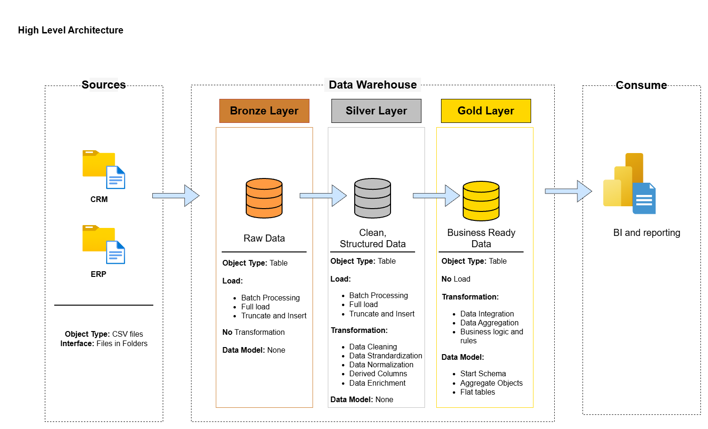

# SQL Data Warehouse Project

A modern data warehouse built with **SQL Server**, covering ETL pipelines, data modeling, and SQL-based analytics. Raw CRM and ERP data is consolidated into a single analytical platform using the **Medallion Architecture** (Bronze → Silver → Gold).

---

## 🏗️ Data Architecture

The warehouse follows the Medallion Architecture:

| Layer | Purpose | Load Type | Transformations |
|-------|---------|-----------|-----------------|
| **Bronze** | Raw data ingested as-is from source CSV files | Batch, full load (truncate & insert) | None |
| **Silver** | Cleansed, standardized, and normalized data | Batch, full load | Cleaning, standardization, normalization, enrichment, derived columns |
| **Gold** | Business-ready data modeled for analytics | No load (views) | Integration, aggregation, business logic, star schema |

```
 CRM (CSV) ─┐                                              ┌─ Reports
            ├─►  Bronze  ─►  Silver  ─►  Gold (Star Schema) ┼─ Dashboards
 ERP (CSV) ─┘                                              └─ Ad-hoc SQL
```



---

## 📖 Project Overview

This project covers:

- **Data Architecture** – Designing a warehouse with Bronze, Silver, and Gold layers.
- **ETL Pipelines** – Extracting data from source systems, transforming it, and loading it into the warehouse.
- **Data Modeling** – Building fact and dimension tables (star schema) optimized for analytical queries.
- **Data Quality** – Cleansing and validating data before analysis.
- **Analytics & Reporting** – SQL-based reports delivering insights into customer behavior, product performance, and sales trends.

### Skills Demonstrated

SQL Development · Data Engineering · ETL Development · Data Modeling · Data Analytics

---

## 🚀 Project Requirements

### Data Engineering — Building the Data Warehouse

**Objective:** Develop a SQL Server data warehouse that consolidates sales data and enables analytical reporting and informed decision-making.

- **Data Sources:** Two source systems (ERP and CRM), provided as CSV files.
- **Data Quality:** Cleanse and resolve data quality issues before analysis.
- **Integration:** Combine both sources into a single, user-friendly data model for analytical queries.
- **Scope:** Latest dataset only; historization of data is not required.
- **Documentation:** Clear documentation of the data model for business and analytics teams.

### Analytics — Reporting & Insights

Develop SQL-based analytics to deliver insights into:

- Customer behavior
- Product performance
- Sales trends

---

## 📂 Repository Structure

```
sql-data-warehouse-project/
│
├── datasets/        # Raw source data (CRM and ERP CSV files)
├── docs/            # Architecture diagrams, data model, naming conventions, data catalog
├── scripts/
│   ├── init_database.sql   # Creates the database and schemas (bronze, silver, gold)
│   ├── bronze/             # DDL and load procedures for raw data
│   ├── silver/             # DDL and transformation procedures
│   └── gold/               # Views for the star schema
├── tests/           # Data quality checks
├── README.md
└── LICENSE
```

> ⚠️ Adjust this tree to match the actual contents of your repo.

---

## 🛠️ Tools & Technologies

- **SQL Server Express** – Database engine
- **SQL Server Management Studio (SSMS)** – Development and administration
- **T-SQL** – ETL, transformations, and analytics
- **Git & GitHub** – Version control
- **Draw.io** – Architecture and data model diagrams

---

## ⚙️ Getting Started

### Prerequisites

- [SQL Server Express](https://www.microsoft.com/en-us/sql-server/sql-server-downloads)
- [SQL Server Management Studio (SSMS)](https://learn.microsoft.com/en-us/sql/ssms/download-sql-server-management-studio-ssms)
- Git

### Setup

1. **Clone the repository**
   ```bash
   git clone https://github.com/saurav-tazz/sql-data-warehouse-project.git
   cd sql-data-warehouse-project
   ```

2. **Create the database and schemas**
   Run `scripts/init_database.sql` in SSMS. This creates the `DataWarehouse` database with the `bronze`, `silver`, and `gold` schemas.

3. **Load the Bronze layer**
   Update the CSV file paths in the bronze load script to point to your local `datasets/` folder, then run:
   ```sql
   EXEC bronze.load_bronze;
   ```

4. **Load the Silver layer**
   ```sql
   EXEC silver.load_silver;
   ```

5. **Create the Gold layer views**
   Run the scripts in `scripts/gold/` to create the dimension and fact views.

6. **Run analytics**
   Query the Gold layer, for example:
   ```sql
   SELECT * FROM gold.fact_sales;
   ```

---

## 🧱 Gold Layer Data Model

The Gold layer exposes a star schema:

| Object | Type | Description |
|--------|------|-------------|
| `gold.dim_customers` | Dimension | Customer details merged from CRM and ERP |
| `gold.dim_products` | Dimension | Product details and categories |
| `gold.fact_sales` | Fact | Sales transactions linked to customers and products |

> ⚠️ Update this table to reflect the objects in your project.

---

## ✅ Data Quality

Checks performed during the Silver layer transformation include:

- Removing duplicates and handling nulls
- Trimming unwanted spaces
- Standardizing categorical values (e.g., gender, marital status, country)
- Validating and fixing date formats and ranges
- Verifying sales, quantity, and price consistency

---

## 📊 Example Analyses

- Customer demographics and segmentation
- Top-performing products and categories
- Sales trends over time
- Revenue contribution by product and customer

---

## 🗺️ Roadmap & Project Planning

This project was planned and tracked in Notion, including the task breakdown, epics, and progress:

👉 **[View the Project Plan on Notion](https://app.notion.com/p/Data-Warehouse-Project-3fb53c1923ef80c0bc4acd6ed147c29a?source=copy_link)**

---

## 🤝 Contributing

Suggestions and improvements are welcome. Fork the repo, create a feature branch, and open a pull request.

## 📄 License

This project is licensed under the [MIT License](LICENSE).

## 👤 Author

**Saurav** — [GitHub](https://github.com/saurav-tazz)

---

*Built for learning and portfolio purposes by following the SQL Data Warehouse tutorial from [Data With Baraa](https://github.com/DataWithBaraa/sql-data-warehouse-project). Full credit for the original project design goes to the original author.*
